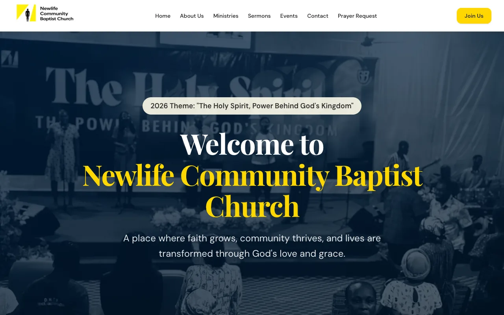
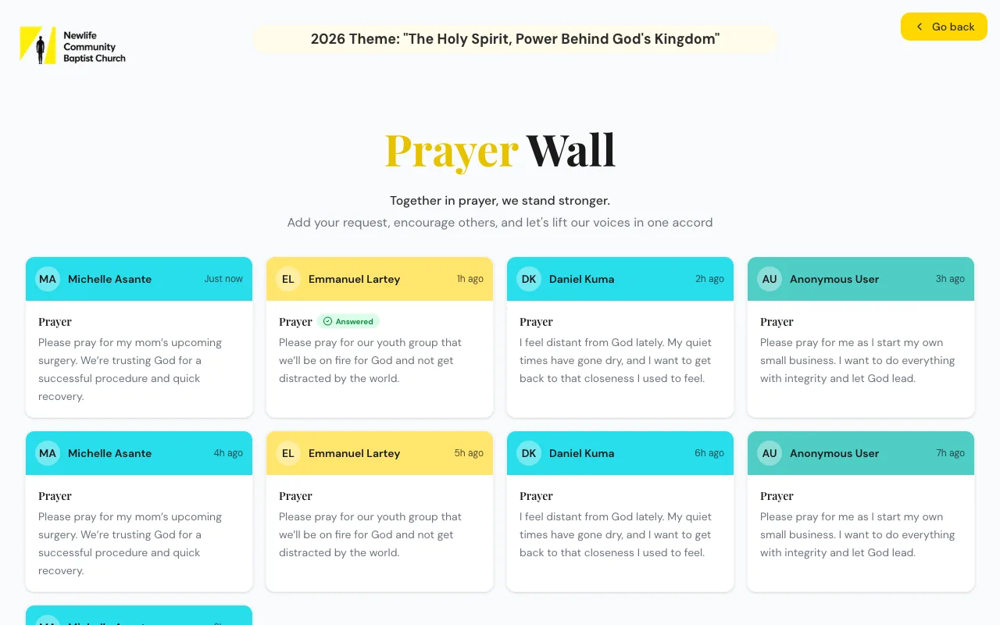

# Newlife Community Baptist Church Website

Official website for **Newlife Community Baptist Church (NLCBC)** — a public church site with sermons, events, and a community prayer wall, plus a secure admin area for managing prayer requests.

[](https://nextjs.org)
[](https://react.dev)
[](https://www.typescriptlang.org)
[](https://tailwindcss.com)

**Live site:** [nlcbcgh.com](https://nlcbcgh.com)



## Table of Contents

- [About](#about)
- [Features](#features)
- [Tech Stack](#tech-stack)
- [Getting Started](#getting-started)
- [Environment Variables](#environment-variables)
- [Available Scripts](#available-scripts)
- [Routes](#routes)
- [Project Structure](#project-structure)
- [Architecture](#architecture)
- [Design System](#design-system)
- [Known Limitations](#known-limitations)
- [Deployment](#deployment)
- [Contributing](#contributing)
- [License](#license)

## About

Newlife Community Baptist Church is a church in Tema, Ghana, affiliated with the Ghana Baptist Convention. This repository contains the church's public website and its prayer ministry tooling:

- A marketing site that introduces the church, its leadership, and weekly gatherings.
- A public prayer wall where anyone can submit a request and pray for others.
- An admin area where church staff review and manage prayer requests.

The project is built as a single Next.js App Router application. Public pages are server-rendered for SEO, while interactive sections (forms, wall, admin tools) are client components. Authentication is handled by NextAuth against the prayer wall backend.

## Features

### Public site

- **Home** — hero, welcome message from the pastor, weekly gathering schedule, latest sermon (YouTube embed), podcast player, upcoming events, and the church's four-step discipleship pathway.
- **About Us** — parallax hero, pastor profile with count-up statistics, ministry philosophy, and Ghana Baptist Convention affiliation.
- **Prayer Request** — three-step request form (request → anonymity choice → contact details) with validation, animated step transitions, and success/failure modals.
- **Prayer Wall** — live requests fetched from the backend with pagination, answered/flagged badges, initials avatars, and relative timestamps.



### Admin area

- **Sign-in** — credentials-based login (NextAuth) against the prayer wall backend.
- **Dashboard** — animated stat cards and a searchable, paginated prayer requests table.
- **Prayer wall** — the public wall inside the admin shell for moderation review.

## Tech Stack

| Layer | Choice |
| --- | --- |
| Framework | [Next.js 16](https://nextjs.org) (App Router, Turbopack) |
| UI | [React 19](https://react.dev), [Tailwind CSS 4](https://tailwindcss.com) |
| Language | [TypeScript 5](https://www.typescriptlang.org) (strict mode) |
| Animation | [Motion](https://motion.dev) (`motion/react`) |
| Forms | [Formik](https://formik.org) + [Yup](https://github.com/jquense/yup) |
| Tables | [TanStack Table](https://tanstack.com/table) |
| Icons | [Lucide](https://lucide.dev), [React Icons](https://react-icons.github.io/react-icons) |
| Auth | [NextAuth v4](https://next-auth.js.org) (credentials, JWT sessions) |
| Media | `next/image`, `@next/third-parties` YouTube embed, RSS.com podcast player |
| Fonts | Playfair Display (headings) + DM Sans (body) via `next/font` |

## Getting Started

### Prerequisites

- **Node.js 20.9+** (minimum for Next.js 16)
- **pnpm** — the committed `pnpm-lock.yaml` is the source of truth for dependencies

### Installation

```bash
git clone https://github.com/geraldofori/newlife-website.git
cd newlife-website
pnpm install
cp .env.example .env.local
```

Fill in the required values in `.env.local` (see [Environment Variables](#environment-variables)), then start the dev server:

```bash
pnpm dev
```

Open **http://localhost:4080** — the dev server is pinned to port `4080` in `package.json`, which matters because `NEXTAUTH_URL` must match it.

> **Note:** The prayer wall and admin login depend on an external backend. In local development the backend's CORS allowlist may reject `http://localhost:4080`, in which case the wall shows an error state. Use the deployed origin or ask the backend maintainers to allow the local port.

## Environment Variables

Copy `.env.example` to `.env.local` and fill in the values:

| Variable | Required | Description |
| --- | --- | --- |
| `NEXTAUTH_URL` | Yes | Base URL of the app. Must match the dev port: `http://localhost:4080` locally, the production URL in deployment. |
| `NEXTAUTH_SECRET` | Yes | Secret used to sign the session cookie. Generate with `openssl rand -hex 32`. |
| `NEXT_PUBLIC_YOUTUBE_LIVE_LINK` | Yes | Embed URL for the latest sermon video shown on the home page. |
| `NEXT_PUBLIC_URL` | No | Public base URL, reserved for absolute URLs in metadata. Not currently referenced in code. |

Never commit `.env.local` or real secrets. `.env.example` is the only env file tracked in git.

## Available Scripts

| Command | Description |
| --- | --- |
| `pnpm dev` | Start the development server on port `4080` |
| `pnpm build` | Create a production build |
| `pnpm start` | Serve the production build (defaults to port `3000`) |
| `pnpm lint` | Run ESLint across the repo with zero warnings allowed |

Run `pnpm lint && pnpm build` before opening a pull request.

## Routes

| Route | Access | Description |
| --- | --- | --- |
| `/` | Public | Home page |
| `/about-us` | Public | About the church, pastor, and affiliation |
| `/prayer-request` | Public | Prayer request landing page with the request modal |
| `/prayer-request/wall` | Public | Public prayer wall |
| `/prayer-request/admin` | Public | Admin sign-in |
| `/prayer-request/admin/dashboard` | Authenticated | Stats and prayer requests table |
| `/prayer-request/admin/prayer-wall` | Authenticated | Prayer wall inside the admin shell |
| `/api/auth/[...nextauth]` | — | NextAuth route handler |

Admin routes are guarded by `proxy.ts` (Next.js 16's middleware). Unauthenticated requests are redirected to `/api/auth/signin` with a `callbackUrl`, which resolves to the admin sign-in page.

## Project Structure

```text
.
├── app/                          # App Router
│   ├── (landing)/                # Home page route group
│   ├── about-us/                 # About page + metadata
│   ├── prayer-request/           # Prayer request, wall, and admin routes
│   │   └── admin/
│   │       ├── (login)/          # Sign-in route group
│   │       └── (dashboard)/      # Authenticated shell (sidebar layout)
│   ├── api/auth/[...nextauth]/   # NextAuth handler
│   ├── globals.css               # Tailwind import + design tokens
│   └── layout.tsx                # Root layout, fonts, session provider
├── components/
│   ├── common/                   # Navbar, footer, buttons, modals, cards, sidebar
│   ├── pages/                    # Page-level compositions
│   └── ui/                       # Feature sections and forms
├── constants/                    # API URLs, nav data, mock data
├── hooks/                        # useModal, useUserSession
├── models/                       # Shared TypeScript interfaces
├── public/images/                # Static assets (logos, hero, pastor portrait)
├── services/                     # NextAuth options and session helpers
├── utils/                        # Animation variants, formatting helpers
├── proxy.ts                      # Route protection (Next.js middleware)
└── docs/                         # README screenshots
```

## Architecture

### Rendering

Public pages are server components that export metadata for SEO. Interactive sections (`"use client"`) handle forms, animations, the live prayer wall, and admin tooling. The root layout loads both fonts via `next/font` and wraps the app in a `SessionProvider` seeded with the server session.

### Authentication flow

```text
Login form (/prayer-request/admin)
  → signIn("credentials")
  → NextAuth authorize()
  → POST {BACKEND_URL}/auth/token (OAuth2 password form)
  → JWT session cookie (24h)
  → proxy.ts guards /prayer-request/admin/*
```

Auth options live in `services/auth.ts`. The backend URL is defined there and in `constants/index.ts` (`API_BASE_URL.PRAYER`).

### Prayer data flow

- **Submit:** `components/ui/RequestForm.tsx` collects the request in three steps and posts to `POST /prayers/submit`. Success and failure are surfaced through `SuccessModal` and `FailedModal`.
- **Wall:** `components/PrayerWallGrid.tsx` calls `GET /prayers/wall?skip=&limit=&sort_by=created_at&sort_order=desc`, transforms the response into the `Prayer` model, and renders paginated cards.

### Shared primitives

- `components/common/CustomButton.tsx` — variant/size button system (`primary`, `secondary`, `outline`, `ghost`).
- `components/common/CustomModal.tsx` — accessible modal (Escape to close, scroll lock, animated presence).
- `utils/animations.ts` — shared Motion variants for consistent scroll and hover behavior.

## Design System

Tokens are defined in `app/globals.css` under Tailwind's `@theme` block and should be used instead of hardcoded colors:

| Token | Value | Usage |
| --- | --- | --- |
| `navy` | `#001F3F` | Primary brand color, dark sections |
| `navy-dark` | `#001730` | Hover states on navy |
| `gold` | `#FFD700` | Accent, CTAs, active states |
| `gold-hover` | `#E6C200` | Hover states on gold |
| `gold-soft` | `#FFFCEB` | Subtle accent backgrounds |
| `ink` | `#1A1A1A` | Headings and primary text |
| `body` | `#2E2E2E` | Body copy |
| `muted` | `#6B7280` | Secondary text |

Typography: **Playfair Display** for headings (`font-heading`) and **DM Sans** for body text (`font-body`). Both are loaded with `next/font` and exposed as CSS variables.

## Known Limitations

- The admin dashboard and requests table currently use mock data from `constants/index.ts`. Table actions (view, approve, delete) are not wired to the backend yet.
- Navigation items for Ministries, Sermons, Stories, Events, Contact, and the "Join Us" CTA are intentional placeholders for features still to be built.
- There is no automated test suite yet. Verification is manual plus `pnpm lint && pnpm build`.
- The prayer wall backend's CORS policy may block local development origins (see [Getting Started](#getting-started)).

## Deployment

The site is deployed on [Vercel](https://vercel.com). To deploy your own instance:

1. Import the repository into Vercel.
2. Set the environment variables from [Environment Variables](#environment-variables) in the project settings. Use the production domain for `NEXTAUTH_URL`.
3. Deploy. Vercel detects Next.js automatically; the build command is `pnpm build`.

For other platforms, see the [Next.js deployment documentation](https://nextjs.org/docs/app/getting-started/deploying).

## Contributing

1. Create a branch off `main`.
2. Make your changes, keeping the existing conventions:
   - Use the design tokens and shared primitives instead of hardcoded styles.
   - Keep page shells as server components and push interactivity into client components.
   - Preserve the placeholder links — they map to features planned for later.
3. Run `pnpm lint && pnpm build` and fix any warnings or errors.
4. Commit using conventional prefixes (`feat:`, `fix:`, `chore:`, `docs:`).
5. Open a pull request describing the change and how you verified it.

## License

No license file is included in this repository. The code and brand assets belong to Newlife Community Baptist Church. Contact the maintainers before reusing or redistributing any part of the project.

## Contact

- **Church:** Newlife Community Baptist Church, Tema, Ghana
- **Email:** [info@nlcbcgh.com](mailto:info@nlcbcgh.com)
- **Website:** [nlcbcgh.com](https://nlcbcgh.com)

Built and maintained by the NLCBC web team.
